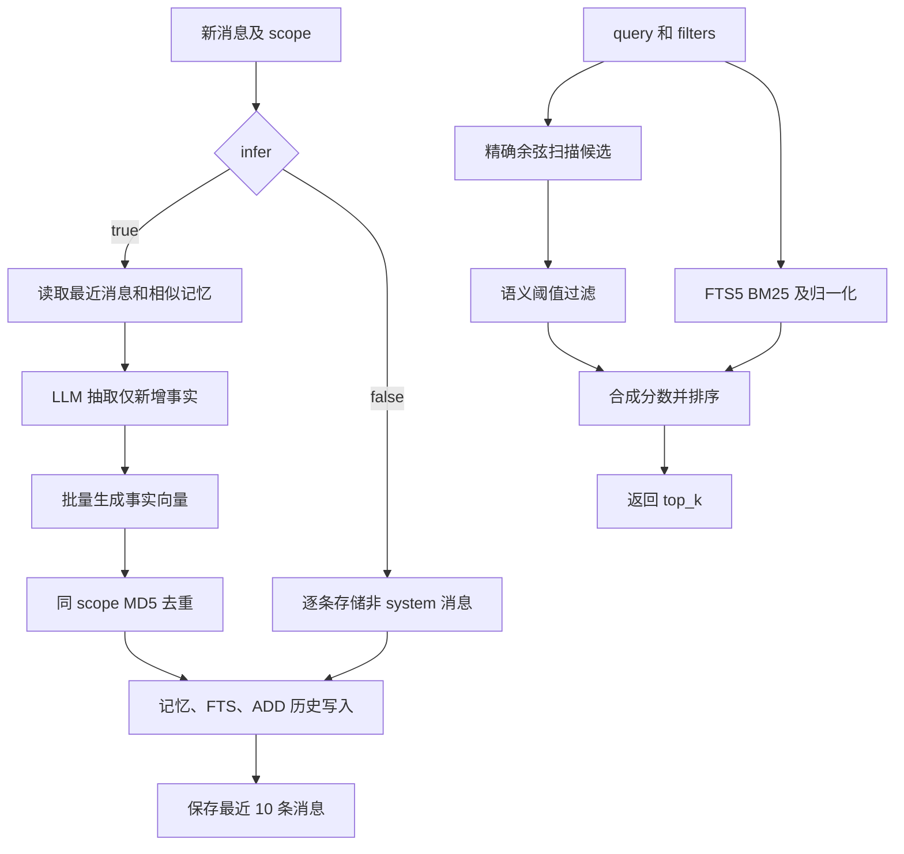

# mini-vector 工作流分析

> 2026-10-22 更新：下文保留 2026-10-02 的旧基线工作流作历史参考。当前默认已改为记忆侧问题生成、三路独立召回、逐路 LLM 重排与 RRF，详见 [RETRIEVAL.md](RETRIEVAL.md)。关闭两项新能力可选择旧检索算法；当前实现已将抽取事实的精确去重提前至事实/问题向量化之前。

本文依据 2026-10-02 的本地实现。`MiniVector` 是同步 Python 记忆库，沿用 mem0 非图模式的核心思路：从新消息抽取可独立理解的事实，生成向量并存入 SQLite；查询先取语义候选，再用 SQLite FTS5 BM25 调整排名。自动抽取仅支持新增，修改和删除由显式管理接口完成。

## 1. 入口与存储结构

核心编排和持久化都在 [memory.py](mini_vector/memory.py)，配置加载在 [config.py](mini_vector/config.py)。`MiniVector` 可注入 `llm`、`embedder` 和 `store`，默认模型客户端使用 OpenAI 兼容接口。

| 对象 | 存储内容 | 用途 |
| --- | --- | --- |
| `memories` | UUID、事实文本、JSON 向量、文本 MD5、metadata | 主记忆和语义搜索 |
| `memory_fts` | 记忆 ID 和文本 | FTS5 全文检索、BM25 排序 |
| `messages` | session scope、角色、内容、name、时间 | 给下一次抽取提供最近消息 |
| `history` | ID、旧文本、新文本、事件、时间 | ADD / UPDATE / DELETE 审计记录 |

构造 `SQLiteVectorStore` 时打开数据库、启用 WAL、建立表和索引。默认文件为当前工作目录的 `mini_vector.sqlite3`。不需要单独调用初始化方法，结束时调用 `close()`。

## 2. 总体工作流



两条查询路径在实现中顺序执行，图中分支表达数据来源，不表示并行任务。

## 3. scope 如何影响整个流程

写入必须提供 `user_id`、`agent_id`、`run_id` 中至少一个非空值；搜索和列表使用 `filters={...}`，批量删除用相同三类参数。scope 值会转换成字符串，排除全空白值，但保留有效标识符的首尾空白。传多个字段时使用 AND 条件。

- 向量、BM25、哈希去重都按调用时提供的 scope 条件筛选。
- 最近消息的 session key 是完整 scope 字典排序后的 JSON。只提供 `user_id` 和同时提供 `user_id + run_id` 会形成两个不同的消息上下文。
- 只按 `user_id` 搜索会包含这个用户不同 run 中的记忆；额外传入 `run_id` 才缩小范围。
- `_scope()` 只接受上述三个字段，其他 filters 不参与查询。任意用户 metadata 是保存和返回的数据，不是高级过滤表达式。

`get(id)`、`update(id)`、`delete(id)`、`history(id)` 直接按 ID 工作，没有额外 scope 参数；应用层若需要访问权限控制，应在调用前确认 ID 所属范围。

## 4. 写入：add(infer=True)

### 4.1 输入标准化与上下文检索

字符串被转换为一条 user 消息，单个字典被转换为消息列表。每条消息必须有字符串 `role` 和 `content`，可保留 `name`。空列表或非法结构报错。

系统把非 system 消息拼成带角色的当前文本。若只有 system 消息或当前文本为空，只保存消息上下文，返回空结果，不调用模型。正常情况下：

1. 读取同一 session 的最近消息，最多 10 条。
2. 对当前文本生成一次向量。
3. 在 scope 内做语义搜索，取最多 10 条已有记忆作为抽取参考。

这里的相似记忆搜索没有采用公开 `search()` 的 BM25 合成和阈值流程，而是直接调用 store 的语义路径。

### 4.2 LLM 抽取新的独立事实

提示词同时提供 `recent_messages`、`new_messages` 和 `existing_memories`。要求只从新消息提取有用信息，用历史上下文消解指代，保留实体、日期和数值，忽略寒暄和重复转述；可包含确有新增信息的 assistant 行动或建议。

默认调用 JSON mode Chat Completions，期望返回 `{"memory":[{"text":"..."}]}`。解析时要求 `memory` 为列表，只保留有非空字符串 `text` 的条目。模型请求失败包装为 `RuntimeError`，JSON 或字段解析失败包装为 `ValueError`。

这一步只产生 ADD，没有自动 UPDATE / DELETE 决策。旧事实即使与新事实冲突，也不会自动失效或被覆盖。

### 4.3 向量化、去重和写入

对全部抽取事实批量生成向量，检查返回数量和非空向量，再计算文本 MD5。数据库查询找出 scope 内相同哈希，本次批次也用 `seen` 集合去重。去重基于去除首尾空白后的精确文本：语义近似但措辞不同的事实可能同时存在。

每条保留事实获得新 UUID。一次 store `save()` 事务同时写入主记录、FTS 文本和 ADD 历史。scope 字段覆盖调用方 metadata 中的同名字段，生成或保留创建时间并设置更新时间。向量在哈希判重之前生成，所以重复事实仍可能消耗 embedding 调用。

最后保存本次全部消息，并裁剪到该 session 最新 10 条。抽取结果为空也保存上下文。返回 `{"results":[{"id":...,"memory":...,"event":"ADD"}]}`。

单条记忆的三个存储对象保持事务一致，但整个 `add()` 的多条记忆和消息保存不属于一个共同事务。如果后续写入失败，先前成功提交的记忆可能已经存在。

## 5. 原始消息写入：add(infer=False)

此分支不调用 LLM。它逐条跳过 system 消息，对其他消息内容生成向量，存为独立记忆；把 `role` 和可选消息 `name`（存为 `actor_id`）加入 metadata，然后保存最近消息上下文。

该分支不执行 `infer=True` 的哈希去重逻辑，同一消息重复调用可以生成多个 ID。它适合原样存储，检索结果粒度是一条消息，而非抽取后的单条事实。

## 6. 查询：search

### 6.1 语义候选是最终结果的入口

默认参数为 `top_k=20`、`threshold=0.1`。query 必须非空、top_k 为正、threshold 在 `[0, 1]` 内，scope 必须有效。

query 向量生成后，系统扫描 scope 内所有记忆向量，在 Python 中计算余弦相似度并排序，取 `candidate_limit = max(top_k * 4, 60)`。本实现将余弦结果裁剪至 `[0, 1]`，零向量得到 0，维度不匹配则报错。

这是精确扫描，没有独立向量数据库或 ANN 索引。计算量约为 `O(N_scope × embedding_dimension)`，还需对扫描结果排序。

### 6.2 BM25 用于调整语义候选顺序

系统把 query 分词后组成带引号的 OR 查询，在同 scope 的 FTS5 表中取最多 `candidate_limit` 条关键词候选。`-bm25(memory_fts)` 转成越大越好的值，池内正分数按最大值归一化，再作 sigmoid：

```text
b = 1 / (1 + exp(-8 * (raw_bm25 / best_raw_bm25 - 0.5)))
```

BM25 候选本身可以与语义候选不同，但最终循环只遍历语义候选。因此关键词独有命中不会直接加入结果，也无法绕过语义阈值。

### 6.3 阈值、分数合成与返回

先排除语义分数 `s < threshold` 的候选。若本次 BM25 返回非空分数字典，最终分数为 `min(1, (s + b) / 2)`，未命中关键词的语义候选取 `b=0`；若 BM25 为空，则最终分数就是 `s`。按最终分数降序，取前 top_k。

这意味着只要词法池非空，语义独有候选也会被除以 2。合成分数是当前查询的排序指标，不是事实正确率或跨查询统一的置信度。

`explain=True` 增加语义、归一化 BM25 和最终分数。结果还包括 ID、记忆文本、scope、时间和用户 metadata。无可用 FTS terms 或 FTS 查询出现 SQLite `OperationalError` 时，词法分数为空，继续使用语义排序。

## 7. 记忆管理与审计

| 方法 | 实际行为 |
| --- | --- |
| `get(id)` / `get_all(filters=...)` | 单 ID 读取 / scope 内列表 |
| `update(id, text, metadata=...)` | 显式替换文本或合并 metadata；传文本时重新 embedding，刷新哈希和 FTS，记录 UPDATE |
| `delete(id)` | 删除主记录和 FTS，保留历史并追加 DELETE |
| `delete_all(...)` | 获取 scope 内记录后逐条删除，返回数量 |
| `history(id)` | 按序返回 ADD、UPDATE、DELETE 的旧文本、新文本和时间 |

update 保留 ID、创建时间和 scope 等受保护字段。删除记忆不删除 `messages` 的近期上下文；更新不会做新增流程中的重复哈希检查。系统没有后台过期、自动遗忘或时间区间失效阶段。

## 8. 追溯能力与工作流边界

`research_trace={}` 记录语义池、BM25 原始与归一化分数、阈值排除、合成排名及最终结果，追踪 metadata 只取允许的来源字段。库本身没有 episode / document / chunk 表，也不会自动为抽取事实建立原消息链接；原文来源需要调用方在 metadata 中提供。`history` 说明记录如何改变，不等价于原文证据链。

这种设计适合小规模本地偏好、计划和日常事实记忆。它以较少组件完成持久化与混合排序，但不具备实体图、自动冲突治理、复杂 metadata 条件或原生回答生成。检索结果要由上层应用交给回答模型。

## 9. 可核对的验证依据

[test_memory.py](tests/test_memory.py) 覆盖抽取、scope、去重、持久化重开、近期上下文、BM25 重排、阈值、原始消息及更新删除历史。[test_config.py](tests/test_config.py) 核对配置来源和显式参数优先级。

本文是静态代码分析，本次仅新增文档，没有执行 API 调用、数据库写入或测试。
